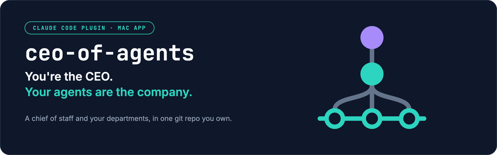

<p align="center">
  
</p>

<p align="center">
  A chief of staff and one agent per department, running in Claude Code and working from one git repo you own.
  You decide. They frame, route, record and build, and stop for your OK before anything important.
</p>

## What it is

- **A chief of staff.** You talk in plain language. It frames the ask, routes it to the right department and records every decision in git.
- **One agent per department.** Engineering, design, legal, finance or your own, each with a charter and only the tools it needs.
- **Approval gates.** Anything public, paid or irreversible waits for your explicit OK.

## Repositories

| Repository | What it is |
|---|---|
| [ceo-of-agents-core](https://github.com/ceo-of-agents/ceo-of-agents-core) | The Claude Code plugin: chief of staff, departments, approval gates. Start here. |
| [ceo-of-agents-desktop](https://github.com/ceo-of-agents/ceo-of-agents-desktop) | The Mac app: chat with your chief of staff and see what waits on you, on your own Claude Code. |
<!-- | [ceo-of-agents-landing](https://github.com/ceo-of-agents/ceo-of-agents-landing) | The download page. | -->

## Get started

1. Install the plugin in Claude Code:

   ```
   /plugin marketplace add ceo-of-agents/ceo-of-agents-core
   /plugin install ceo-of-agents@ceo-of-agents
   ```

2. In an empty folder, run `/ceo-of-agents:init-fleet` and answer the questions.
3. Optional, on a Mac: [download the app](https://github.com/ceo-of-agents/ceo-of-agents-desktop/releases/latest) and open the org you just set up.

Full guide in the [plugin README](https://github.com/ceo-of-agents/ceo-of-agents-core#readme).

---

<sub>An independent open-source project, not affiliated with Anthropic. "Claude Code" names the tool it runs in.</sub>
